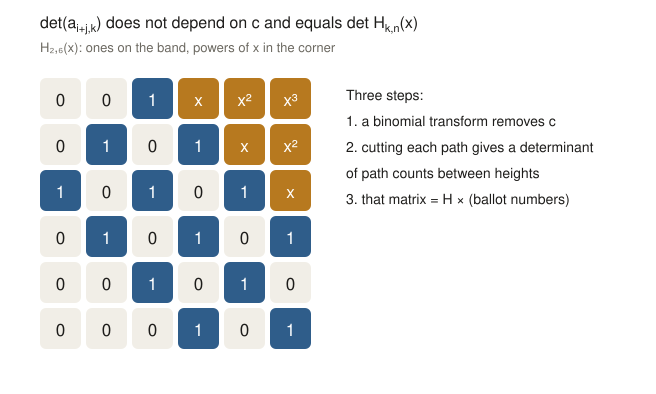

# Cigler's Hankel determinants of path generating functions do not depend on the horizontal weight

<!-- visual:start -->
<p align="center"></p>

<p align="center"><b>det(a<sub>i+j,k</sub>) equals det H<sub>k,n</sub>(x) for all k and n (and, classically, does not depend on c).</b><br><sub>Open problem settled · formally verified in Lean 4</sub></p>

<p align="center"><sub><a href="paper">paper</a> · <a href="lean">Lean proof</a> · <a href="verify">code</a> · <a href="../">all results</a></sub></p>
<!-- visual:end -->

Weight the horizontal steps of a Motzkin path by `c + x` at height 0 and by `c` above it, and let `a_{n,k}` count the paths of length `n` from height 0 to height `k`. Johann Cigler observed ([MathOverflow 456683](https://mathoverflow.net/q/456683), 2023; [arXiv:2309.15557](https://arxiv.org/abs/2309.15557), p. 5; the shift question already on [Math.SE 4428971](https://math.stackexchange.com/q/4428971), 2022) that the Hankel determinants `D_{k,n}(x,c) = det(a_{i+j,k})_{0≤i,j<n}` seem not to depend on `c`, and that they appear to equal `det H_{k,n}(x)` for an explicit band matrix of ones and powers of `x`.

Both statements hold for all `k` and `n` (Theorem 1). Independence of `c` is classical: adding `c` to every horizontal weight is a binomial transform, and Hankel determinants are invariant under it (Layman, J. Integer Seq. 2001; Spivey and Steil, J. Integer Seq. 2006, Theorem 6.1). The new part is the identity with `det H_{k,n}(x)`. Cutting each path in two turns the Hankel determinant into a determinant of path counts from height `l` to height `k`. That matrix factors as `H_{k,n}(x)` times a unitriangular matrix of ballot numbers, which depends on neither `k` nor `x`; the content is one local identity for the entries of `H`. Cigler's further quadratic recurrence for `det H_{k,n}(x)` was open at release; this folder checks it numerically for `k ≤ 5`, `n < 22` and does not prove it (see "Since release" below).

Preprint v1, 18 November 2026, not peer reviewed; released before the author's own line-by-line reading. Zenodo: [doi:10.5281/zenodo.24353081](https://doi.org/10.5281/zenodo.24353081), identical to this folder at tag `cigler-hankel-paths-v1`. Theorem 1 is formally verified in Lean 4 over any commutative ring (`lean/`, standard axioms only), with `H_{k,n}(x)` written exactly as in the question. The author used AI tools (Claude, Anthropic, to find the proof and write the code, Lean and text; Codex, OpenAI, to review the release) and is responsible for the content.

**Since release (23 November 2026).** Cigler's quadratic recurrence, left open above, has been proved by T. Yu ([arXiv:2611.27575](https://arxiv.org/abs/2611.27575)), who also gives an independent proof of Theorem 1, and by H. Sun ([arXiv:2611.27755](https://arxiv.org/abs/2611.27755)), via the Hirota–Miwa equation. Both papers cite this preprint.

## Contents

- `paper/`: `hankel.tex` and `hankel.pdf`.
- `lean/`: a Lake project pinned to Lean 4.34.0 and Mathlib v4.34.0. `lean/README.md` maps each result to its Lean name; `CheckClaims.lean` prints the statements and axioms; `scripts/mutants.toml` (run by `scripts/mutate.py`) holds 66 planted wrong changes, each of which must stop the build; `axiom-validation.txt`, `build-validation.log` and `mutation-validation.log` record the isolated build.
- `verify/`:
  - `check.py`: an independent check that shares no code with the other program or the Lean (integers only, its own Bareiss determinant). It compares `D_{k,n}(x,c)` at two values of `c` with `det H_{k,n}(x)` at six random integer points for `1 ≤ k ≤ 5`, `n < 22`, and checks the open quadratic recurrence in the same range. Exit status nonzero on any failure.
  - `verify.py`: checks each step of the proof symbolically (Step 1 for `n ≤ 16` in `x, c`; Step 2 for `k ≤ 4`, `i, j < 8`; Step 3 for `k ≤ 5`, `n = 12`), and that perturbing any single entry of `H` in 20 random trials, or putting `c ≠ 0` inside the path counts of Step 3, breaks Step 3.
  - `mutants.toml` with `harness/mutate.py`: five implementation mutants of `check.py` (the boundary weight, the band of `H`, the powers of `x`, the determinant's sign, the Hankel index), each of which must make the unchanged checks fail.

## Reproduce

```
cd verify
python3 -I check.py                          # under a second
python3 -I harness/mutate.py mutants.toml    # five mutants, each rejected
python3 -I verify.py                         # needs sympy; a few seconds
cd ../paper && latexmk -pdf hankel.tex
cd ../lean && lake exe cache get && lake build LeanProofs && lake env lean CheckClaims.lean
python3 -I scripts/mutate.py scripts/mutants.toml   # 66 mutants (long); then `lake build LeanProofs` again
```

## Licence

The paper is released under [CC BY 4.0](../LICENSE-PAPERS), the code under the [MIT licence](../LICENSE-CODE). Mathlib is a pinned dependency (Apache-2.0), fetched by `lake`, not redistributed here.
