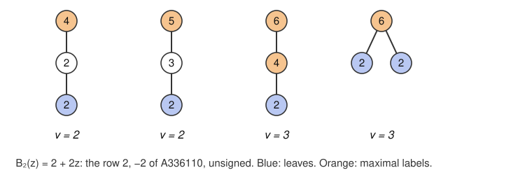

# The description-tree refinement of the Gross–Witten–Wadia numerators (OEIS A336110)

<!-- visual:start -->
<p align="center"></p>

<p align="center"><b>For every s ≥ 1, the unsigned row s of A336110 counts the description trees of type (2,2) with s edges by ν = leaves + maximal internal vertices.</b><br><sub>Voloshyn's conjecture (A336110, arXiv:2609.31189 §4.6, arXiv:2611.11670 §3.7), proved; the interpretations in A401900 follow.</sub></p>

<p align="center"><sub><a href="paper">paper</a> · <a href="lean">Lean proof</a> · <a href="verify">code</a> · <a href="../">all results</a></sub></p>
<!-- visual:end -->

The large-`N` limit of `SU(N)` lattice integrals produces rational functions `P_s(x)` whose numerators have integer coefficients of alternating sign: `1`; `2, −2`; `5, −14, 5`; `14, −74, 74, −14`; … (OEIS A336110). The unsigned rows add up to `1, 4, 24, 176, …`, the number of rooted bridgeless planar cubic maps, which Cori and Schaeffer encode as *description trees of type (2,2)*: rooted plane trees whose leaves have label 2, whose other vertices have a label between 2 and 2 plus the sum of their children's labels, and whose root has the largest label allowed. Voloshyn conjectured, and checked for `s ≤ 9`, that row `s` counts these trees with `s` edges by `ν`, the number of leaves plus the number of internal vertices whose label is the largest allowed.

This note proves the conjecture for every `s`: `P_s(x) = x B_s(−x)/(1+x)^{3s+1}` in lowest terms, where `B_s(z) = Σ z^{ν(τ)−2}` over the trees with `s` edges. The proof keeps the root label as a catalytic variable, solves the resulting quadratic equation by Tutte's quadratic method in a rational parametrisation, and checks that the parametrised series satisfies the third-order differential equation that determines the hypergeometric term `Ω(k,m) = 12^k/((k+1)!(2k+1)!) ∏_{L≤k} C(m+2L, 3)` behind A336110. With Voloshyn's identity (64) of arXiv:2609.31189v3, the interpretation that OEIS A401900 records as conditional follows. The proof is not bijective; the path bijection that A401900 asks for is still open.

Preprint v1, 26 November 2026, not peer reviewed; released before the author's line-by-line reading. Zenodo: [doi:10.5281/zenodo.24561485](https://doi.org/10.5281/zenodo.24561485), identical to this folder at the tag `description-tree-refinement-v1`.

AI use: Claude Opus 5.5 (Anthropic) found the proof, wrote the scripts and the Lean formalisation, and drafted the text. Codex (OpenAI) ran an independent literature search and an independent check of every step, which found one sign error in a displayed resultant (corrected) and wrote the recheck program in `verify/recheck/`.

## Contents

- `paper/`: `descriptiontrees.tex` and `descriptiontrees.pdf`.
- `verify/` (Python 3 with SymPy). Each verification script below exits nonzero if a check fails and refuses to run under `python3 -O` (the mutation runner `mutants/mutate.py` is a tool, not a check).
  - `brute.py`: counts the trees by `ν` directly from the definition (rows for `s ≤ 10`); with `--check` it asserts the rows against the A336110 data for `s ≤ 8`.
  - `target.py`: the identity `z B_k(z)/(1−z)^{3k+1} = Σ_m Ω(k,m) z^m` against `brute.py`, for `k ≤ 12` (finite check).
  - `catalytic_check.py`: the catalytic equation (1) of the note reproduces the brute-force rows for `k ≤ 9` (finite check).
  - `quadratic.py`: the resultant of Step 2, checked to equal `256 t^4 (t(1+q)^2 − 4z) R(q,t)` with `R(q,0) = −zq` (exact).
  - `param.py`: the double-root system of Step 2 solved for `(t, q)`, checked to be the parametrisation (2) (exact).
  - `pde_proof.py`: the identity `𝓛H = 0` of Step 3, exact in `ℚ(p, z)`.
  - `links_check.py`: the parametrisation solves the quartic (exact); Lemma 2 for `s ≤ 10`, `r ≤ 20` (finite; the general case is proved in the note and in Lean); a series cross-check.
  - `run_all.py`: runs `target.py`, `catalytic_check.py`, `pde_proof.py` and `links_check.py`.
  - `recheck/independent.py`: Codex's recheck, sharing no code: every plane tree and labelling for `s ≤ 8`, and exact checks of integrality, positivity, symmetry, the `Ω` recurrence, Lemma 2 and Corollary 3 for `s ≤ 20`.
  - `mutants/`: six suites with `mutate.py`, fourteen false variants of the scripts' claims; every one is rejected.
- `lean/`: a Lean 4 project pinned to the Mathlib version it was checked with; `lean/README.md` maps the formalised statements (the `Ω` recurrence and its uniqueness, Lemma 2, the quartic identity of Step 2) to the note, and lists what is checked by SymPy instead.

## Reproduce

```
cd verify
pip install sympy
python3 brute.py 10 && python3 brute.py --check
python3 run_all.py
python3 quadratic.py && python3 param.py
python3 recheck/independent.py
cd mutants && for s in a_brute a_target b_catalytic c_pde d_links e_calc; do python3 mutate.py $s.toml; done && cd ..
cd ../lean && lake exe cache get && lake build && lake env lean CheckClaims.lean
cd ../paper && latexmk -pdf descriptiontrees.tex
```

`run_all.py` takes about 7 minutes (mostly `pde_proof.py` and `links_check.py`); the mutation suites about 20; the rest under a minute. The Lean mutation suite: `cd lean/scripts && python3 mutate.py mutants.toml`.

## Licence

The paper is released under [CC BY 4.0](../LICENSE-PAPERS), the code under the [MIT licence](../LICENSE-CODE).
