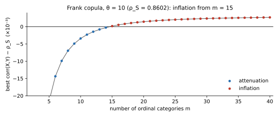

# Discretising a Frank copula can inflate linear correlation: a disproof of Barbiero's attenuation conjecture

<!-- visual:start -->
<p align="center"></p>

<p align="center"><b>Cutting a Frank pair into fifteen ordinal categories can give scores more correlated than the latent pair, so the conjectured attenuation fails, and it fails for every nonzero parameter.</b><br><sub>Conjecture disproved · closed-form regression, non-affinity and first variation verified in Lean 4 · example certified by two independent interval-arithmetic programs</sub></p>

<p align="center"><sub><a href="paper">paper</a> · <a href="lean">Lean proof</a> · <a href="verify">code</a> · <a href="../">all results</a></sub></p>
<!-- visual:end -->

Take a pair of uniform random variables `(U, V)` joined by a Frank copula, cut each at fixed thresholds into ordinal categories scored `1, 2, ..., m`, and compare the Pearson correlation of the scores with Spearman's rho of the latent pair. Barbiero ([Adv. Data Anal. Classif. 2026, doi:10.1007/s11634-026-00709-1](https://doi.org/10.1007/s11634-026-00709-1), Sections 2.2 and 5) conjectured from numerical evidence with at most eleven categories that the scores are never more correlated than the latent pair, with equality only in limiting cases.

This note proves:

- **Theorem 1.2.** For every Frank parameter `θ ≠ 0` there are cut-points with `|corr(X, Y)| > |ρ_S(θ)|`.
- **Proposition 5.1.** At `θ = 10` (`ρ_S = 0.86023`), fifteen categories on each variable, cut at the same fourteen rationals (`27/250, 193/1000, ..., 223/250`), give `corr(X, Y) = 0.86039`, a gap of `1.5315 × 10⁻⁴`, certified in interval arithmetic.

The mechanism: the regression `E[V | U = u]` of the Frank copula has a closed form that is never affine (its values at `u = 1/8, 1/4, 1/2` are not collinear), so a slight increasing rescaling of `U` correlates better with `V` than `U` does, and integer scores of a fine enough discretisation inherit the gain.

Preprint v1, 24 November 2026, not peer reviewed. Zenodo: [doi:10.5281/zenodo.24497009](https://doi.org/10.5281/zenodo.24497009), identical to this folder at tag `frank-copula-inflation-v1`. The author used AI tools (Claude, Anthropic; Codex, OpenAI) in this work, as the paper's Section 6 describes, and is responsible for its content.

## Contents

- `paper/`: `frank.tex`, `frank.pdf` and the figure data.
- `verify/` (Python 3). Each program exits nonzero if its results differ from the paper's.
  - `certify_arb.py`: Proposition 5.1 in Arb ball arithmetic (python-flint), including Spearman's rho through the Debye functions. Output `certify_arb.out`.
  - `independent_check.py`: the same certificate by a separately written program sharing no code (mpmath 70-digit intervals, Spearman's rho through zeta(2) and zeta(3) with tail bounds), plus exact checks of Lemma 2.1 and of the variational lemma on test densities. Output `independent_check.out`.
  - `defect_identity.py`: the identity of Lemma 3.2 exactly (sympy), and Proposition 3.1 against quadrature. Output `defect_identity.out`.
  - `numerics/`: the uncertified exploration behind Table 2 and the figures (`numerics/README.md`).
- `lean/`: a Lean 4 project pinned to the Mathlib version it was checked with; `lean/README.md` lists what is formalised and what is not.

## Reproduce

```
cd verify
python3 certify_arb.py
python3 independent_check.py
python3 defect_identity.py
cd ../lean && lake exe cache get && lake build && lake env lean CheckClaims.lean
cd ../paper && latexmk -pdf frank.tex
```

Dependencies: `python-flint`, `mpmath`, `sympy`, `numpy`, `scipy`. The three programs take under a minute each. The Lean mutation suite: `cd lean/scripts && python3 mutate.py mutants.toml` (about 10 minutes).

## Licence

The paper is released under [CC BY 4.0](../LICENSE-PAPERS), the code under the [MIT licence](../LICENSE-CODE).
