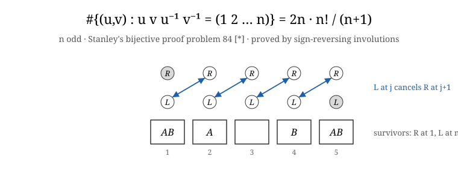

# A combinatorial count of the commutators equal to a long cycle (Stanley's Problem 84)

<!-- visual:start -->
<p align="center"></p>

<p align="center"><b>For odd n, the n-cycle (1, 2, …, n) is a commutator u v u⁻¹ v⁻¹ in exactly 2n·n!/(n+1) ways, and here is a combinatorial proof.</b><br><sub>Stanley, Bijective Proof Problems, Problem 84 [*]: "a combinatorial proof of the problem is not known".</sub></p>

<p align="center"><sub><a href="paper">paper</a> · <a href="lean">Lean</a> · <a href="verify">code</a> · <a href="../">all results</a></sub></p>
<!-- visual:end -->

For odd `n`, the number of pairs `(u, v)` of permutations of `{1, …, n}` with `u v u⁻¹ v⁻¹ = (1, 2, …, n)` is `2n·n!/(n+1)`. The count is Exercise 7.68(d) of Stanley's *Enumerative Combinatorics*, vol. 2 (recorded in OEIS A052145); the classical proof uses Frobenius's formula: only the hook characters of `S_n` are nonzero on the long cycle, and the count is `n! Σ_k (−1)^k / C(n−1, k)`. Stanley lists the statement in his *Bijective Proof Problems* (Problem 84), marked `[*]`: a combinatorial proof is not known. For `n = 3` there are nine pairs, and in exactly three of them `u` is a 3-cycle; a combinatorial proof has to explain that fraction `1/n`.

This note gives a combinatorial proof. It starts from the Goupil–Schaeffer formula for bipartite unicellular maps in the bijective form of Chapuy, Féray and Fusy (arXiv:1202.3252, Prop. 9), repackages the commutator count as a set `O_n` of permutations with marked points and decorated cycles, and cancels `O_n` by explicit sign-reversing involutions down to a signed count `W_{n−1}` of marked words with a cut, which a flagged telescope evaluates. The three identities are `O_n = 2^{n+1}(n−1)!|F_n|`, `O_n = 4·n!·W_{n−1}` and `(n+1)W_{n−1} = 2^n·n!`. No characters or generating functions are used. The proof is combinatorial but not a direct bijection: the Chapuy–Féray–Fusy step obtains its bijection from a regular correspondence by Hall's theorem (computable by exhaustive search, with no efficient construction known), and a direct bijection is still open.

Preprint v1, 26 November 2026, not peer reviewed; released before the author's line-by-line reading. Zenodo: [doi:10.5281/zenodo.24572233](https://doi.org/10.5281/zenodo.24572233), identical to this folder at the tag `long-cycle-commutators-v1`.

AI use: the cancellation argument (Sections 4 and 5 of the note) was found by OpenAI's Codex (GPT-6.1) from a brief prepared with Claude. Claude Opus 5.5 (Anthropic) did the earlier reductions, checked every step of the argument by hand, wrote the independent verification program and the Lean formalisation, and drafted the note.

## Contents

- `paper/`: `commutator.tex` and `commutator.pdf`.
- `verify/` (Python 3, standard library only). Each check exits nonzero on failure and refuses to run under `python3 -O`.
  - `independent.py` (Claude): `|F_n|` from all factorisations of the long cycle, the Goupil–Schaeffer formula with `I = J` against brute force for every composition, and `O_n`, `W_{n−1}` by brute force from their definitions; asserts all three identities for `n = 1, 3, 5, 7`.
  - `codex_check.py` (Codex, shares no code with `independent.py`): enumerates the commutator solutions for `n ≤ 9`, the two finite models, and exhaustively checks the local sign maps and involutions on small cases; includes four planted mutations.
  - `run_all.py`: runs both.
  - `mutants/claims.toml` with `mutate.py`: seven false variants of the note's claims; every one is rejected.
- `lean/`: a Lean 4 project pinned to the Mathlib version it was checked with. `lean/README.md` maps the formalised identities to the note.

## Reproduce

```
cd verify
python3 run_all.py
python3 mutants/mutate.py mutants/claims.toml
cd ../lean && lake exe cache get && lake build && lake env lean CheckClaims.lean
cd ../paper && latexmk -pdf commutator.tex
```

`run_all.py` takes a few minutes (most of it is `n = 9` in `codex_check.py`); the mutation suite about ten.

## Licence

The paper is released under [CC BY 4.0](../LICENSE-PAPERS), the code under the [MIT licence](../LICENSE-CODE).
