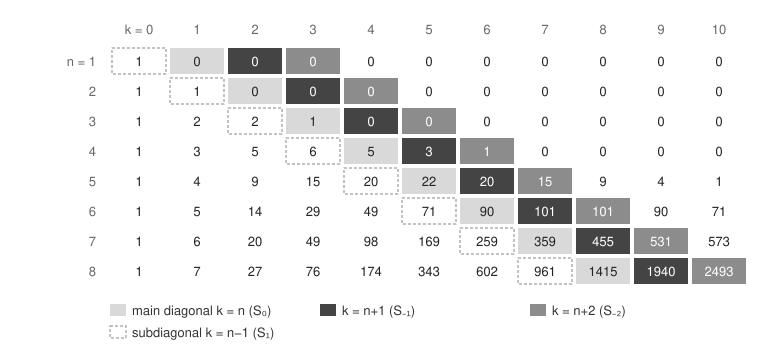

# The superdiagonals of the Mahonian triangle: a proof of Conjecture 15 of Claesson, Franklín and Steingrímsson

<!-- visual:start -->
<p align="center"></p>

<p align="center"><b>Every superdiagonal of the Mahonian triangle is the main diagonal divided by a power of xC(x), plus a rational correction P<sub>i</sub>/(1−x)<sup>i</sup> of exact degree 3i−2.</b><br><sub>Conjecture 15 of Claesson, Franklín and Steingrímsson (Electron. J. Combin. 30(4) (2023), P4.7), proved.</sub></p>

<p align="center"><sub><a href="paper">paper</a> · <a href="lean">Lean proof</a> · <a href="verify">code</a> · <a href="../">all results</a></sub></p>
<!-- visual:end -->

Let `I_n(k)` be the number of permutations of `[n]` with `k` inversions and `S_i(x) = Σ_n I_n(n−i) xⁿ` the generating function of the diagonal `k = n − i`. Claesson, Franklín and Steingrímsson proved `S_i = (xC)ⁱ S_0` for `i ≥ 0`, with `C` the Catalan generating function, and conjectured that above the main diagonal

    xⁱ S_{−i}(x) = S_0(x) C(x)^{−i} + P_i(x) / (1 − x)ⁱ,   P_i ∈ ℤ[x] of degree 3i − 2.

This note proves the conjecture, with an explicit formula for `P_i` and its leading term `(−1)ⁱ x^{3i−2}` (`i ≥ 2`). The Mahonian product is Euler's product times `(1−q)^{−n}`, corrected by `∏_{j>n}(1−q^j)^{−1} = 1 + q^{n+1}/(1−q) + O(q^{2n+2})`. Lagrange inversion for Laurent series gives the main term; single parts of the correction give the denominator `(1−x)ⁱ`; the first two-part partition `(n+1)+(n+1)` gives the leading term. The coefficient-level truncation for `k < 2n+2` is in Mennen's 2010 note, credited in the paper.

Preprint v1, 25 November 2026, not peer reviewed; released before the author's line-by-line reading. Zenodo: [doi:10.5281/zenodo.24536366](https://doi.org/10.5281/zenodo.24536366), identical to this folder at the tag.

AI use: the proof was found with Claude (Anthropic), which also wrote the verification programs and (with a subagent) the Lean formalisation; Codex (OpenAI) ran an independent literature search, a line-by-line check of the proof and the second verification program.

## Contents

- `paper/`: `superdiagonals.tex` (with `fig_mech.tex`) and `superdiagonals.pdf`.
- `verify/` (Python 3, standard library only). Each program exits nonzero if a claim fails.
  - `explicit_check.py`: the explicit formula for `P_i` against `(1−x)ⁱ(xⁱS_{−i} − C^{−i}S_0)` computed from Mahonian rows, `i ≤ 8`; degree `3i−2`, leading coefficient `(−1)ⁱ`, `c_{i−2} = 1`; `P_1`–`P_4` equal the polynomials printed by Claesson, Franklín and Steingrímsson. Output `explicit_check.out`.
  - `recheck_codex.py`: an independent recheck sharing no code (all permutations to `n = 8`, all partitions to 35, Lemmas 2–4, `P_i` for `i ≤ 40`). Output `recheck_codex.out`.
  - `mutants.toml` with `mutate.py`: ten false variants of the claims (including a changed coefficient of the printed P_3); every one is rejected.
- `lean/`: a Lean 4 project pinned to the Mathlib version it was checked with; `lean/README.md` lists what is formalised and what is not (Lemma 3, Lagrange inversion for Laurent series, is a stated hypothesis citing Gessel 2016).

## Reproduce

```
cd verify
python3 explicit_check.py
python3 recheck_codex.py
python3 mutate.py mutants.toml
cd ../lean && lake exe cache get && lake build && lake env lean CheckClaims.lean
cd ../paper && latexmk -pdf superdiagonals.tex
```

The programs take under a minute each; the Python mutation suite about two minutes. The Lean mutation suite: `cd lean/scripts && python3 mutate.py mutants.toml` (about 10 minutes).

## Licence

The paper is released under [CC BY 4.0](../LICENSE-PAPERS), the code under the [MIT licence](../LICENSE-CODE).
