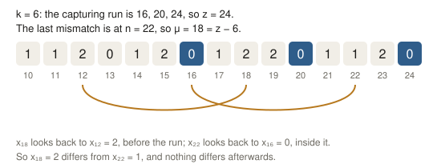

# The moment of capture in a quadratic recurrence modulo 3

<!-- visual:start -->
<p align="center"></p>

<p align="center"><b>Finch's Conjecture 23 holds for every k ≥ 3 and fails for k = 2.</b><br><sub>Published conjecture settled · Lean 4 for k ≥ 6 and k = 2, computation for k = 3</sub></p>

<p align="center"><sub><a href="paper">paper</a> · <a href="lean">Lean proof</a> · <a href="verify">code</a> · <a href="../">all results</a></sub></p>
<!-- visual:end -->

Fix `k ≥ 2`, start from `x_1 = … = x_{k-1} = 0`, `x_k = 1`, and set `x_n = x_{n-1} + x_{n-k}^2` in `Z/3`. For many `k` the sequence wanders for a very long time (for `k = 403` the pre-period is about `10^11`) and then falls into a cycle of length 4. Steven Finch ([arXiv:2610.34300](https://arxiv.org/abs/2610.34300), Conjecture 23) conjectured that the fall always happens in the same way: if `z` is the end of the first run of zeros spaced exactly four apart that is long enough to force the cycle, and `μ` is the pre-period, then `z − μ = 6`.

This holds for every `k ≥ 3` with a capture point, and fails for `k = 2`, where `z = 9` but `μ = 0`. Inside the capturing run each step looks back exactly `k` places, onto the stretch just before the run, so the run fixes which of those earlier terms are zero. Minimality of `z` then forces the one remaining term, and that term makes the block before the last disagree with the cycle while everything after it agrees.

Preprint v1, 18 November 2026, not peer reviewed; released before the author's own line-by-line reading. Zenodo: [doi:10.5281/zenodo.24352081](https://doi.org/10.5281/zenodo.24352081), identical to this folder at tag `moment-of-capture-v1`. The theorem for `k ≥ 6` and the counterexample at `k = 2` are formally verified in Lean 4 (`lean/`, standard axioms only); `k = 3` is checked by computation. The `k = 2` counterexample is also recorded, with a Lean formalisation, in the Omega Institute's public repository ([issue 23615](https://github.com/the-omega-institute/trureturing/issues/23615)); the proof for `k ≥ 3` is not there. The author used AI tools (Claude, Anthropic, to find the proof and write the code, Lean and text; Codex, OpenAI, to check the proof independently) and is responsible for the content.

## Contents

- `paper/`: `capture.tex` and `capture.pdf`.
- `lean/`: a Lake project pinned to Lean 4 and Mathlib (see `lean/lean-toolchain` and `lean/lake-manifest.json`); `lean/README.md` maps results to Lean names, `CheckClaims.lean` prints their axioms, `axiom-validation.txt` and `build-validation.log` record the isolated build.
- `verify/`:
  - `check_proof.py`: computes every quantity in each step of the proof (the bound of Step 1, the forced values of Step 3, the two middle entries, and `μ` from its definition) for every capturing `k ≤ 60`, and checks `k = 2, 3` directly. Exit 0 on success.
  - `capture.c`: confirms `z − μ = 6` and the periodic tail for the 31 capturing `k` in `61..140`; the other nine showed no capture within `10^9` steps. Output in `capture_61_140.txt`.
  - `mutants.toml` with `harness/mutate.py`: eight planted errors in `check_proof.py`, each of which must be rejected.
  - `independent/`: an independent check written by Codex that shares no code with the above. `independent_check.cpp` recomputes `μ`, the period, `z` and `z − μ` for every `k ≤ 60` from the literal recurrence (`independent_results.txt`); `independent_exhaustive.py` reads that table, re-derives it in Python, and checks Finch's Lemma 17 and Proposition 12 exhaustively.

## Reproduce

```
cd verify
python3 -I check_proof.py
python3 -I harness/mutate.py mutants.toml
cc -O2 -o capture capture.c && ./capture 61 140 1000000000
cd independent
c++ -O2 -std=c++17 -o ic independent_check.cpp && ./ic > /tmp/ic.txt && diff /tmp/ic.txt independent_results.txt
python3 -I independent_exhaustive.py
cd ../../paper && latexmk -pdf capture.tex
cd ../lean && lake exe cache get && lake build LeanProofs && lake env lean CheckClaims.lean
```

`capture.c` takes about half a minute for `61..140`. Python needs only the standard library.

## Licence

The paper is released under [CC BY 4.0](../LICENSE-PAPERS), the code under the [MIT licence](../LICENSE-CODE). Generated outputs and logs are released under CC BY 4.0. Mathlib is a pinned dependency (Apache-2.0), fetched by `lake`, not redistributed here.
