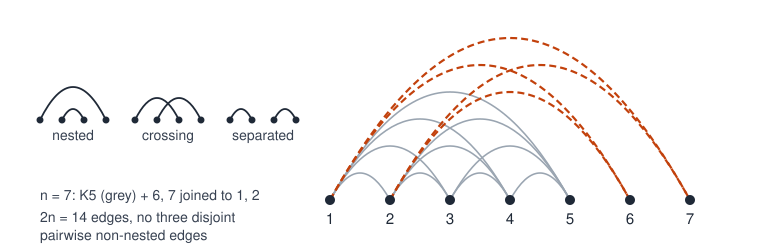

# Non-nested matchings in ordered graphs: the cases k = 3 and k = 4 of the Barát–Freschi–Tóth conjecture

<!-- visual:start -->
<p align="center"></p>

<p align="center"><b>f<sub>3</sub>(n) = f*<sub>3</sub>(n) = 2n for n ≥ 6, and f*<sub>4</sub>(n) ≥ 3n + 1 for n ≥ 9: an ordered graph with no three disjoint, pairwise non-nested edges has at most 2n edges, while the strong form of the conjecture fails for four edges.</b><br><sub>Conjecture 2.6 of Barát, Freschi and Tóth (arXiv:2512.15461), settled for k = 3 and, in its strong form, for k = 4.</sub></p>

<p align="center"><sub><a href="paper">paper</a> · <a href="lean">Lean proof</a> · <a href="verify">code</a> · <a href="../">all results</a></sub></p>
<!-- visual:end -->

Two disjoint edges of a graph on `[n]` are nested when one lies strictly inside the other. Let `f_k(n)` be the largest number of edges of an ordered graph on `[n]` with no `k` pairwise disjoint, pairwise non-nested edges, and `f*_k(n)` the same with only *strongly* non-nested matchings forbidden (crossing an equivalence relation on the matching). Barát, Freschi and Tóth proved `(k−1)n ≤ f_k(n) ≤ f*_k(n) ≤ (k−1)n + C(k−1, 2)` and conjectured `f_k(n) = f*_k(n) = (k−1)n`; de Castro (arXiv:2609.14484) disproved this for every `k ≥ 5`.

This note proves `f_3(n) = f*_3(n) = 2n` for every `n ≥ 6`, and shows that the strong form fails for `k = 4`: a graph on 9 vertices with 28 edges and no strongly non-nested 4-matching, extended to `3n + 1` edges for every `n ≥ 9`. For `k = 3`, eight short edges must form two small stars that fence in every other edge; in the equality case of the Barát–Freschi–Tóth count the long edges complete a 2-triangulation, and the star polygons of Pilaud and Santos force three pairwise crossing edges. The plain form for `k = 4` stays open; it holds for `n ≤ 13`.

Preprint v1, 25 November 2026, not peer reviewed; released before the author's line-by-line reading.

AI use: the proof route of Theorem 1 was found with Codex (OpenAI); Claude (Anthropic) did the computations, found the reduction to the equality case and the two-star structure numerically, found the graph of Theorem 2 and its proof, checked every step against the sources, wrote the verification programs, drafted the text and (with a subagent) the Lean formalisation.

## Contents

- `paper/`: `nonnested.tex` and `nonnested.pdf`.
- `verify/` (Python 3 with `python-sat`). Each program exits nonzero if a claim fails.
  - `values.py` with `fk.py`: every value stated in the note (f_3 and f*_3 for n = 6..11, f_4 for n = 8..13, f*_4 for n = 9..13, and the control f_5(11) = 45 from de Castro), each by a SAT instance at the value and an UNSAT instance one above. Output `values.out`.
  - `recheck_values.py`: the same values from a separate enumeration and solver, sharing no code. Output `recheck_values.out`.
  - `recheck_g9.py`: Theorem 2 without SAT: G9 and its extensions to n = 12 contain no strongly non-nested 4-matching. Output `recheck_g9.out`.
  - `mutants.toml` with `mutate.py`: eight false variants of the stated values; every one is rejected.
- `lean/`: a Lean 4 project pinned to the Mathlib version it was checked with; `lean/README.md` lists what is formalised (Theorems 1 and 2, Lemmas 3 and 4) and the two cited theorems that enter as hypotheses (Capoyleas–Pach, Pilaud–Santos).

## Reproduce

```
cd verify
pip install python-sat
python3 values.py
python3 recheck_values.py
python3 recheck_g9.py
python3 mutate.py mutants.toml
cd ../lean && lake exe cache get && lake build && lake env lean CheckClaims.lean
cd ../paper && latexmk -pdf nonnested.tex
```

`values.py` takes about 10 minutes and `recheck_values.py` about 15; the others under two minutes. The Lean mutation suite: `cd lean/scripts && python3 mutate.py mutants.toml` (about 4 minutes).

## Licence

The paper is released under [CC BY 4.0](../LICENSE-PAPERS), the code under the [MIT licence](../LICENSE-CODE).
