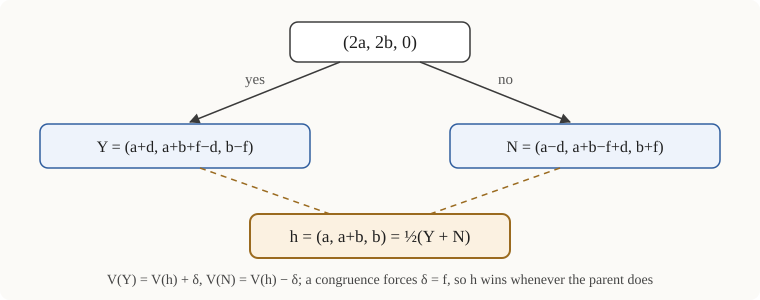

# Even splitting is optimal in the Rényi–Ulam game with two lies

<!-- visual:start -->
<p align="center"></p>

<p align="center"><b>From a position in which every class is even, asking about exactly half of each class is never beaten when up to two answers may be lies.</b><br><sub>Pálvölgyi's conjecture settled for e = 2 · argument above depth 15 verified in Lean 4 · depths up to 15 by a certificate checked by two independent programs</sub></p>

<p align="center"><sub><a href="paper">paper</a> · <a href="lean">Lean proof</a> · <a href="verify">code</a> · <a href="../">all results</a></sub></p>
<!-- visual:end -->

In the Rényi–Ulam game one finds an unknown element by yes-or-no questions, and up to `e` of the answers may be lies. A position records how many candidates are contradicted by `0, 1, ..., e` answers. Pálvölgyi asked on [MathOverflow 165093](https://mathoverflow.net/q/165093) (2014), and stated as the first conjecture of a note the same year, that from a position in which every class has even size it is always optimal to ask about exactly half of each class. He expected it to be false. The case `e = 1` follows from the work of Ellis, Ponomarenko and Yan.

This note proves:

- **Theorem 1.2.** Let `e = 2`. If the position `(2a, 2b, 2c)` can be won in `n` questions, then its halving child `(a, a+b, b+c)` can be won in `n − 1`. In particular even splitting is optimal at every even position with at least two candidates.

Above depth 15 the proof is a congruence argument: the halving child is the midpoint of the two children of any first question, whether it can be won is decided by a single congruence modulo `gcd(n, C(n,2))`, and moving from the midpoint to either child shifts the volume and the last class by amounts that agree modulo that number and are too small to differ by a multiple of it. Depths up to 15 are settled by a certificate of 645 integers. For three lies an exhaustive search finds no counterexample among halving children with at most 100 candidates; the case `e ≥ 3` stays open.

Preprint v1, 24 November 2026, not peer reviewed. The author used AI tools in this work (Codex, OpenAI, found the proof and the certificate; Claude, Anthropic, checked it, reproduced the certificate independently, wrote the Lean formalisation and the text), as the paper's Section 8 describes, and is responsible for its content.

## Contents

- `paper/`: `ulam.tex`, `ulam.pdf`.
- `verify/` (Python 3 and a C compiler). Both programs exit nonzero if a checked value differs.
  - `verify_proof.py`: checks the certificate `base_frontiers.json` (the frontiers `B_0, ..., B_15`) through the frontier recurrence of Section 6, the 44 boundary cases of Lemma 3.1 at depth 12, and Theorem 1.2 at depths up to 15. Output `verify_proof.out`.
  - `recheck_frontiers.py`: an independent recheck sharing no code. It compiles `liar.c`, an exact solver that searches the game tree from the definitions of a position and a question, reproduces all 645 certificate values, agrees with Zare's seven published values from the MathOverflow comments, and checks Table 1 and the introduction's example. Output `recheck_frontiers.out`.
  - `search/`: logs of the halving searches (`liar 2 300` and `liar 3 100`), the evidence of Section 7.
- `lean/`: a Lean 4 project pinned to the Mathlib version it was checked with; `lean/README.md` lists what is formalised and the one hypothesis that is not.

## Reproduce

```
cd verify
python3 verify_proof.py
python3 recheck_frontiers.py
cc -O2 -o liar liar.c && ./liar 2 300 && ./liar 3 100
cd ../lean && lake exe cache get && lake build && lake env lean CheckClaims.lean
cd ../paper && latexmk -pdf ulam.tex
```

`verify_proof.py` takes seconds and `recheck_frontiers.py` a few minutes; the two searches take much longer and only reproduce the logs in `verify/search/`. The Lean mutation suite: `cd lean/scripts && python3 mutate.py mutants.toml`.

## Licence

The paper is released under [CC BY 4.0](../LICENSE-PAPERS), the code under the [MIT licence](../LICENSE-CODE).
