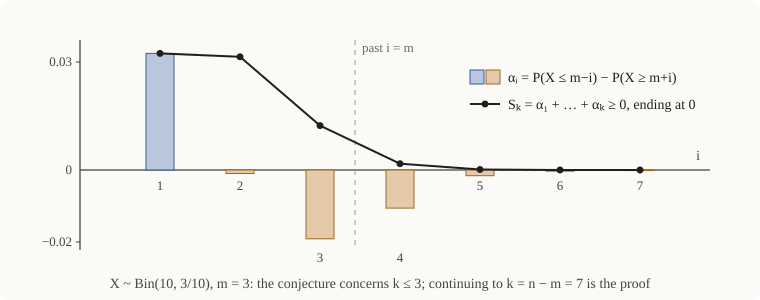

# Binomial distributions with integer mean are left-loaded

<!-- visual:start -->
<p align="center">= m+i) for X ~ Bin(10, 3/10), continued past i = m = 3 up to i = 7: one positive bar, then negative bars; the partial sums stay positive and fall to zero exactly at i = 7"></p>

<p align="center"><b>The lower tail of an integer-mean binomial wins near the mean and loses further out, but every partial sum of the differences stays positive, as Fokkink, Papavassiliou and Pelekis conjectured.</b><br><sub>Conjecture proved · binomial theorem verified in Lean 4 · Poisson and negative binomial cases by the same lemma · exact checks to n = 400</sub></p>

<p align="center"><sub><a href="paper">paper</a> · <a href="lean">Lean proof</a> · <a href="verify">code</a> · <a href="../">all results</a></sub></p>
<!-- visual:end -->

Let `X ~ Bin(n, m/n)` with `n ≥ 2m`, so the mean `m` is an integer, and put `α_i = P(X ≤ m − i) − P(X ≥ m + i)`. Simmons proved in 1894 that `α_1 > 0` when `n > 2m`. Fokkink, Papavassiliou and Pelekis ([Probab. Math. Statist. 42 (2022)](https://doi.org/10.37190/0208-4147.00050), Conjecture 4.1) conjectured that every partial sum `α_1 + ... + α_k`, `1 ≤ k ≤ m`, is nonnegative (they call this left-loadedness), and wrote that it "seems to be hard to prove". The same question is [MathOverflow 384456](https://mathoverflow.net/q/384456) (2021).

This note proves:

- **Theorem 1.2.** For `n > 2m ≥ 2`, the sequence `α_1, ..., α_m` starts positive and changes sign at most once, from positive to negative, and every partial sum is strictly positive. For `n = 2m` every `α_i` is zero.
- **Lemma 2.2.** Any nonnegative integer-valued variable with integer mean `m` is left-loaded when the reflected differences `P(X = m + i) − P(X = m − i)` are negative and then nonnegative.
- **Propositions 4.1 and 4.2.** Poisson variables with integer mean (a short new proof of the authors' Lemma 3.7) and the negative binomial distributions `NB(r, 1 − 1/n)` (for which the authors remarked that left-loadedness "appears to be true") are left-loaded.

The idea: continue `α_i` past `i = m` up to `i = n − m`. The full sum is then exactly zero, because it equals `E(m − X)⁺ − E(X − m)⁺ = m − E X`, and the sequence is valley-shaped, because one quadratic decides the sign of the reflected differences. A valley-shaped sequence that ends below zero is positive and then negative, so its partial sums rise and then fall back to exactly zero, and are positive on the way.

Preprint v1, 24 November 2026, not peer reviewed. The author used AI tools in this work (Codex, OpenAI, found the proof of Theorem 1.2; Claude, Anthropic, checked it, found the general lemma and the Poisson and negative binomial cases, wrote the Lean formalisation and the text), as the paper's Section 5 describes, and is responsible for its content.

## Contents

- `paper/`: `simmons.tex`, `simmons.pdf`.
- `verify/` (Python 3; `sympy` for `identities.py`). Every program exits nonzero if a check fails.
  - `exact_scan.py`: every `2 ≤ n ≤ 400`, `1 ≤ m ≤ n/2` (40,000 pairs) in exact integer arithmetic: no negative partial sum, at most one sign change. Output `exact_scan.out`.
  - `independent_scan.py`: a separately written scan sharing no code, `n ≤ 150`, with `α` continued to `n − m`: strict positivity, the zero total, `α_{n−m} = −m^n` (times `n^{−n}`), Simmons' inequality, the sign pattern, and the numbers printed in the paper (the `Bin(7, 3/7)` example and the Figure 1 data). Output `independent_scan.out`.
  - `identities.py`: the ratio identities of Lemma 3.1 and Propositions 4.1 and 4.2 symbolically, the negative binomial identity also against its probabilities, and the introduction's decimals. Output `identities.out`.
  - `nb_check.py`: the negative binomial partial sums exactly for `r ≤ 6`, `n ≤ 7`. Output `nb_check.out`.
- `lean/`: a Lean 4 project pinned to the Mathlib version it was checked with; `lean/README.md` lists what is formalised and what is not.

## Reproduce

```
cd verify
python3 exact_scan.py --max-n 400
python3 independent_scan.py 150
python3 identities.py
python3 nb_check.py
cd ../lean && lake exe cache get && lake build && lake env lean CheckClaims.lean
cd ../paper && latexmk -pdf simmons.tex
```

The Lean mutation suite: `cd lean/scripts && python3 mutate.py mutants.toml`.

## Licence

The paper is released under [CC BY 4.0](../LICENSE-PAPERS), the code under the [MIT licence](../LICENSE-CODE).
