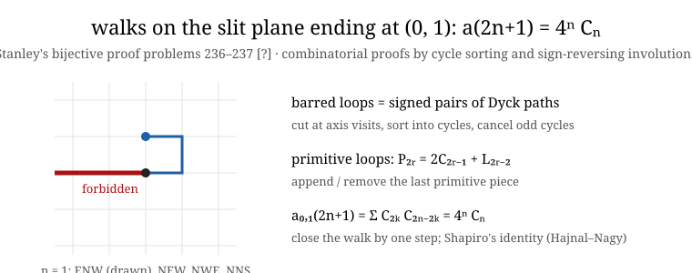

# Catalan numbers on the slit plane: combinatorial proofs (Stanley's Problems 236–237)

<!-- visual:start -->
<p align="center"></p>

<p align="center"><b>Square-lattice walks of length 2n+1 that avoid the half-line {(−k, 0) : k ≥ 0} and end at (0, 1) number 4ⁿCₙ; here are combinatorial proofs of this and the neighbouring slit-plane formulas.</b><br><sub>Stanley, Bijective Proof Problems, Problems 236–237, marked [?]: "uncertain whether a combinatorial proof is known".</sub></p>

<p align="center"><sub><a href="paper">paper</a> · <a href="lean">Lean</a> · <a href="verify">code</a> · <a href="../">all results</a></sub></p>
<!-- visual:end -->

A walk on the slit plane starts at the origin and never returns to the half-line `{(−k, 0) : k ≥ 0}`. Bousquet-Mélou and Schaeffer (2002), Bousquet-Mélou (2001) and Xin (2004) found, by solving functional equations, that many such walks are counted by Catalan numbers: for instance `a_{0,1}(2n+1) = 4ⁿCₙ` for square-lattice walks ending at `(0, 1)`. Stanley collects these formulas as Problems 236 and 237 of his *Bijective Proof Problems* and marks seven of them `[?]`. For `n = 1` the four walks are `ENW`, `NEW`, `NWE`, `NNS`.

This note gives combinatorial proofs of 236(a), (b), (c), (d), (e) and 237(d), (e), and of the identity `b_{1,1}(2n+1) + b_{−1,1}(2n+1) = 2·4ⁿCₙ`, which gives 237(b) together with any combinatorial proof of 237(a) (Stanley lists 237(a) without the `[?]` mark; we have not located its proof). The walks are cut at their visits to the horizontal axis and the pieces sorted into cycles (the Spitzer–Bohnenblust cycle lemma); barred loops are then identified with signed pairs of Dyck paths by sign-reversing involutions, and a closing step turns the endpoint `(0, 1)` into Shapiro's convolution `Σ C₂ₖC₂ₙ₋₂ₖ = 4ⁿCₙ`, which has a bijective proof by Hajnal and Nagy. The formulas are known; only the proofs are new. They are finite counting arguments, not direct bijections, and they are a combinatorial form of Bousquet-Mélou's factorisation with logarithms of generating functions. A direct bijection for 236(a) remains open.

Preprint v1, 27 November 2026, not peer reviewed; released before the author's line-by-line reading. Zenodo: DOI to be added at release, identical to this folder at the tag `slit-plane-catalan-v1`.

AI use: the argument was found by OpenAI's Codex (GPT-6.1) from a brief prepared with Claude, after earlier unsuccessful attempts recorded with Claude. Claude Opus 5.5 (Anthropic) checked every step by hand, wrote the independent verification program and the Lean formalisation, and drafted the note.

## Contents

- `paper/`: `slit.tex` and `slit.pdf`.
- `verify/` (Python 3, standard library only). Each check exits nonzero on failure and refuses to run under `python3 -O`.
  - `independent.py` (Claude): transfer-matrix counts of square and diagonal slit walks; asserts every identity of the proof for `n ≤ 7`, recomputes the cyclic weights `c_s(m, i)` from atom words for `m ≤ 10`, and rebuilds the loop counts from them through Lemma 4.
  - `codex_check.py` (Codex, shares no code with `independent.py`): all endpoint identities for `n ≤ 8`, every square step word up to length 8, the cycle-sorting bijections and their inverses on all increment lists of length at most 5 with all labellings, the involution of Lemma 9, the marking argument of Lemma 6; six planted mutations.
  - `tree_bijection.py` (Codex): an explicit tree bijection for Shapiro's identity, checked with its inverse for `n ≤ 5`.
  - `run_all.py`: runs all three.
  - `mutants/claims.toml` with `mutate.py`: eleven false variants of the note's claims; every one is rejected.
- `lean/`: a Lean 4 project pinned to the Mathlib version it was checked with. `lean/README.md` maps the formalised identities to the note.

## Reproduce

```
cd verify
python3 run_all.py
python3 mutants/mutate.py mutants/claims.toml
cd ../lean && lake exe cache get && lake build && lake env lean CheckClaims.lean
cd ../paper && latexmk -pdf slit.tex
```

`run_all.py` takes a few seconds; the mutation suite under a minute.

## Licence

The paper is released under [CC BY 4.0](../LICENSE-PAPERS), the code under the [MIT licence](../LICENSE-CODE).
