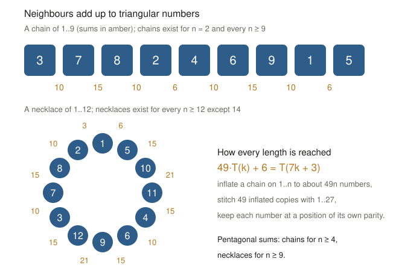

# Triangular and pentagonal chains: 1, 2, ..., n in a row with every neighbouring sum triangular

<!-- visual:start -->
<p align="center"></p>

<p align="center"><b>Triangular chains exist for n = 2 and every n ≥ 9; necklaces for every n ≥ 12 except 14.</b><br><sub>Open problem settled (Berlekamp and Guy) · induction verified in Lean 4 · finite cases certified by an independent recheck</sub></p>

<p align="center"><sub><a href="paper">paper</a> · <a href="lean">Lean proof</a> · <a href="verify">code</a> · <a href="../">all results</a></sub></p>
<!-- visual:end -->

Can the numbers `1, 2, ..., n` be written in a row so that every two neighbours add up to a triangular number? Berlekamp and Guy (*Fibonacci plays billiards*, Crux Math. 46(8), 2020, pp. 334-347, [arXiv:2002.03705](https://arxiv.org/abs/2002.03705); the manuscript dates from 2003) found such a chain for `n = 2` and for every `n` from 9 to 70, and a closed loop (necklace) for `12 ≤ n ≤ 70` except `n = 14`, and wrote on p. 343 that they would like to see proofs. They also reported that chains with generalized pentagonal sums `k(3k-1)/2` seem to exist for all `n ≥ 4` and necklaces for all `n ≥ 9` (pp. 344-345). The counts of triangular chains are in [OEIS A116980](https://oeis.org/A116980) up to `n = 35`.

All four statements hold for every `n` (Theorems 1 and 2). The proof inflates a chain on `1, ..., n` to one on about `49n` numbers using `49 T_k + 6 = T_{7k+3}` (for pentagonal sums, `49 P_k + 2 = P_{7k-1}`), and stitches 49 inflated copies together with the numbers `1, ..., 27`. It follows the scheme Gerbicz used for perfect squares (2018); for triangular numbers it becomes simpler, because every number can be kept at a position of its own parity. The finite ingredients are a base of chains for `54 ≤ N ≤ 2673` (pentagonal: `60 ≤ N ≤ 2965`), 98 stitching arrangements, and the small cases.

Preprint v1, 20 November 2026, not peer reviewed; released before the author's own line-by-line reading. Zenodo: [doi:10.5281/zenodo.24397796](https://doi.org/10.5281/zenodo.24397796), identical to this folder at tag `triangular-pentagonal-chains-v1`. What is verified how: the induction (inflation identity, the stitching step for general `n`, validity of all 98 arrangements, the small chains and necklaces, and the existence halves of both theorems, conditional on the base chains) is formalised in Lean 4 (`lean/`, standard axioms only), with the base chains as an explicit hypothesis `BaseHyp`, because 3.6 and 4.4 million numbers are too many to state as Lean data. The base chains, the arrangements and the small cases are checked by an independent program that shares no code with the generators, and the nonexistence claims for small `n` by two different searches. The author used AI tools (Claude, Anthropic, to find the arguments and write the code, Lean and text; Codex, OpenAI, to search the literature and to review the draft and the release) and is responsible for the content.

## Contents

- `paper/`: `trichains.tex` and `trichains.pdf` (9 pp).
- `verify/` (triangular sums):
  - `base_chains.txt.gz`: one good chain for each `54 ≤ N ≤ 2673` (one line per `N`: `N v1 ... vN`), written by `base_gen.c`.
  - `layouts.json`: the 98 stitching arrangements, keyed `"r,p"` (`N = 49n + r`, `p = n mod 2`), written by `../generate/layout_cp.py`.
  - `small_certificates.json`: chains for `n = 2, 9..53` and necklaces for `12..53` except 14, written by `small_cases.py` (depth-first search).
  - `recheck/recheck.py`: the independent check of the base chains, the five stitching conditions S1-S5 for all 98 arrangements, the small certificates, and a rebuild of sample chains up to 200000. Shares no code with the generators.
  - `recheck/exclusions.py`: no chain for `3..8`, no necklace for `3..11` or `14`, by dynamic programming over subsets (independent of the depth-first search).
  - `recheck/mutants.toml` with `recheck/mutate.py`: 16 planted errors (a corrupted chain, a wrong shift, a moved offset window, a wrong endpoint, false exclusions), each of which must make the unchanged checks fail; log in `recheck/mutation-log.txt`. The runner counts a mutant as rejected only on a failed assertion or a deliberate nonzero exit; an unrelated Python exception is reported as inconclusive.
  - `assemble.py`, `check_e2e.py`, `check_level2.py`: build actual chains from the data and check them directly.
- `generate/`: `layout_cp.py` (with `layout.py`, `aligned.py`) finds the 98 arrangements with CP-SAT.
- `pentagonal/`: the same layout for generalized pentagonal sums (offsets `-23..25`, glue `1..25`; chains start at 3 and end at 2 for even length, 19 for odd). Base chains `60 ≤ N ≤ 2965`; small cases chains `4..59`, necklaces `9..59`; nonexistence: no chain for 2 or 3, no necklace for `3..8`; 12 mutants.
- `lean/`: a Lake project pinned to Lean 4.34.0 and Mathlib v4.34.0, namespaces `TriChains` and `PentChains`. `lean/README.md` maps each result to its Lean name; `CheckClaims.lean` prints `BaseHyp` and the headline statements with their axioms; `scripts/trichains_mutants.toml` and `scripts/pentchains_mutants.toml` (run by `scripts/mutate.py`) hold 12 and 10 planted wrong changes, each of which must stop the build; `axiom-validation.txt` and `build-validation.log` record the isolated build.

## Reproduce

```
python3 -I verify/recheck/recheck.py                        # about a second
python3 -I verify/recheck/exclusions.py
python3 -I verify/recheck/mutate.py verify/recheck/mutants.toml   # 16 mutants, each rejected
python3 -B verify/check_e2e.py 12000                        # builds every chain 54 <= N <= 12000, ~15 s
python3 -B verify/check_level2.py                           # two levels of inflation
(cd pentagonal && python3 -I verify/recheck/recheck.py && python3 -I verify/recheck/exclusions.py \
   && python3 -I verify/recheck/mutate.py verify/recheck/mutants.toml)   # 12 mutants

# regenerate the data (byte-identical to the shipped files)
cc -O2 -o /tmp/tbg verify/base_gen.c && /tmp/tbg 54 2673 | cmp - <(gzip -dc verify/base_chains.txt.gz)
cc -O2 -o /tmp/pbg pentagonal/verify/base_gen.c && /tmp/pbg 60 2965 2 19 3 | cmp - <(gzip -dc pentagonal/verify/base_chains.txt.gz)
(cd generate && python3 layout_cp.py 2 9 28 76 && cmp layouts_2_9_28_76.json ../verify/layouts.json)   # needs ortools
(cd pentagonal/generate && python3 layout_cp.py 2 19 3)     # needs ortools; rewrites ../verify/layouts.json in place

cd paper && latexmk -pdf trichains.tex
cd ../lean && lake exe cache get && lake build LeanProofs && lake env lean CheckClaims.lean
```

`base_gen` exits 1 if any chain is not found, and `layout_cp.py` exits 1 if any of the 98 cases is unsolved. The pentagonal layout generator overwrites `pentagonal/verify/layouts.json`; `git diff` afterwards shows nothing if it reproduces.

## Licence

The paper is released under [CC BY 4.0](../LICENSE-PAPERS), the code under the [MIT licence](../LICENSE-CODE). Mathlib is a pinned dependency (Apache-2.0), fetched by `lake`, not redistributed here.
